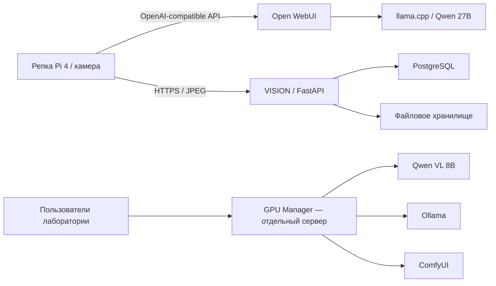

# Local LLM Servers

Локальная инфраструктура искусственного интеллекта для университетских лабораторий и студенческих проектов. Вычисления выполняются на собственных GPU-серверах, а клиентские устройства, включая Репку Pi 4, обращаются к ним по API.

## Архитектура

## Состояние на 26.11.2026

| Компонент | Состояние |
|---|---|
| Debian 13: Qwen VL, Ollama, ComfyUI, GPU Manager | Ранее развёрнут; текущий статус требует уточнения |
| ALT Server 11.1: Qwen 27B, Open WebUI | Работает |
| Репка Pi 4: сетевой API и авторизация | Подтверждены |
| Текстовый ответ через API | Генерация подтверждена; короткий финальный ответ без thinking ещё не проверен |
| VISION: FastAPI, PostgreSQL, HTTPS | Прототип установщика; развёртывание не подтверждено |
| Анализ фотографий нейросетью на новом сервере | Планируется |

## Документация

- [Архитектура и конфигурации](docs/architecture.md)
- [Развёртывание LLM](docs/llm-alt.md)
- [Интеграция Репки](docs/kiosk-api.md)
- [Сервер фотографий](docs/vision.md)
- [Дорожная карта](ROADMAP.md)
- [Правила безопасности](SECURITY.md)
- [Установщик VISION](deploy/vision/install-vision.sh)

## Принципы

Локальная обработка, минимальная графическая среда, раздельные вычислительные задачи, ограниченные права сервисных пользователей. Не публикуются рабочие адреса, ключи, пароли, фотографии студентов и внутренние конфигурации с секретами. Адреса задаются оператором при развёртывании.

Проект находится на стадии лабораторного прототипа; не предназначен для обработки реальных персональных данных до реализации необходимых мер защиты. Лицензия на собственный код пока не выбрана; сторонние компоненты сохраняют свои лицензии.
